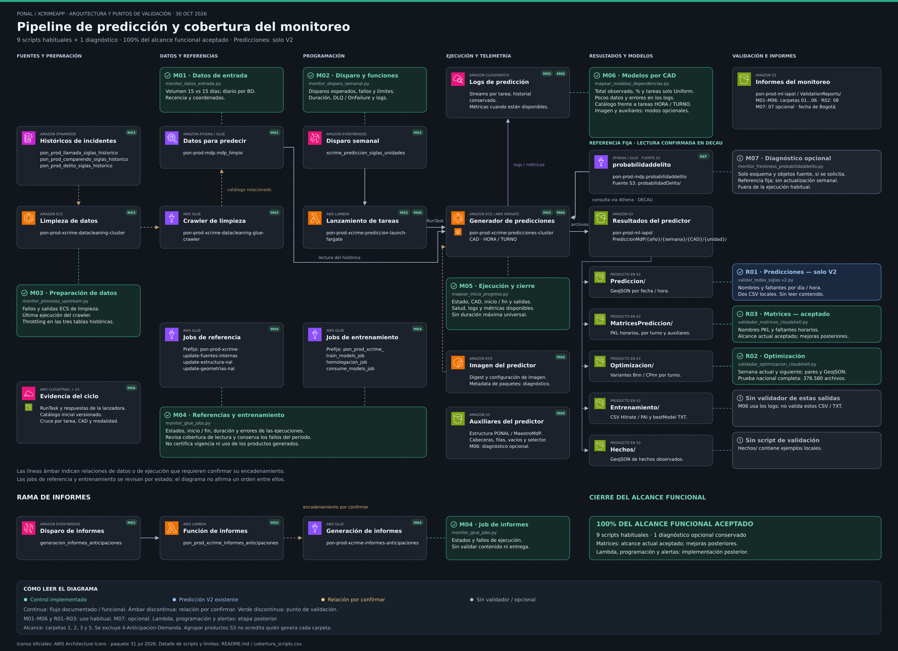

# Pipeline de predicción y sus validaciones

Actualizado al **30 de octubre de 2026**. Incluye las carpetas 1, 2, 3 y 5 de
`3-Prediccion`; excluye `4-Anticipacion-Demanda`. Para los resultados de
`Prediccion/` se considera únicamente **`validar_todas_siglas v2.py`**.

## Estado del alcance

**100% del alcance funcional aceptado para esta etapa:** nueve scripts de uso
habitual —M01–M06 y R01–R03— y un diagnóstico opcional, M07. Se conservan los diez
archivos. El generador documental D01 no forma parte de ese conteo.

Matrices se acepta con sus controles actuales y las mejoras detectadas quedan
para después. M07 sale de la ejecución habitual: `probabilidaddelito` se trata
como referencia fija, sin una obligación de actualización semanal.

El porcentaje expresa avance y aceptación del alcance acordado. La implementación
en Lambda, la programación y las alertas automáticas pertenecen a la etapa posterior.
Tampoco equivale al porcentaje de fallas posibles que el sistema detecta.

## Diagramas y descarga

- **Arquitectura con logos AWS:** [PNG](pipeline_aws.png), [SVG ampliable](pipeline_aws.svg), [PDF](pipeline_aws.pdf) y [fuente editable draw.io](pipeline_aws.drawio).
- **Pipeline y validaciones:** [PNG](pipeline_validaciones.png), [SVG](pipeline_validaciones.svg), [Mermaid editable](pipeline_validaciones.mmd).
- **Guía de scripts:** [PNG](guia_cobertura.png), [SVG](guia_cobertura.svg).
- **PDF de dos páginas:** [pipeline y guía de scripts](pipeline_validaciones.pdf).
- **Paquete vigente completo:** [pipeline_y_validaciones_2026-10-30.zip](pipeline_y_validaciones_2026-10-30.zip).
- **Detalle:** [arquitectura AWS](README_arquitectura_aws.md), [inventario de cobertura](cobertura_scripts.csv) y [evidencia del cierre](EVIDENCIA_Y_ESTADO_2026-10-30.md).

El ZIP incluye los gráficos, sus fuentes editables, las guías y los iconos.
Los enlaces al código de los scripts y a los análisis de resultados requieren
el repositorio completo; esos archivos no se duplican en el paquete documental.

## Cómo leer los diagramas

- **M01–M06:** monitores habituales del proceso.
- **M07:** diagnóstico opcional de la referencia de probabilidades; no es un pendiente de construcción.
- **R01:** validador de predicciones V2. **R02:** optimización. **R03:** matrices.
- **Verde:** control implementado o alcance actual aceptado. **Azul:** V2 existente. **Gris:** diagnóstico opcional o producto fuera del alcance de validación, según el texto.
- Las flechas continuas muestran un flujo o una lectura documentada. Las líneas discontinuas identifican una revisión o una relación por confirmar, según su etiqueta.
- Los conectores **P** de la vista clara identifican la misma referencia `probabilidaddelito`, leída por el predictor; la comprobación directa corresponde a DECAU.

Los puntos de validación son scripts e informes, no alarmas AWS desplegadas.
Repetir un ID en varias etapas representa el mismo archivo; no añade otro script
ni significa que un monitor lance al siguiente.

## Cobertura actual por archivo

| ID | Archivo y evidencia | Qué revisa | Estado y límite actual |
|---|---|---|---|
| M01 | [monitor_datos_entrada.py](../../5-Jobs%20and%20task/1.%20Datos%20antes%20de%20predecir/monitor_datos_entrada.py#L451) | Athena mdp_limpio: volumen 15 vs 15 dias, diario, BD RNMC/SECAD/SIEDCO, ultima fecha, dias sin registros y coordenadas. | **Aceptado en alcance actual.** El modo por periodos excluye fechas no interpretables/futuras; fecha del hecho no es ingestion. Sin catalogo no detecta todas las unidades ausentes. |
| M02 | [monitor_disparo_semanal.py](../../5-Jobs%20and%20task/2.%20Programaci%C3%B3n%20y%20lanzamiento/monitor_disparo_semanal.py#L150) | Dos reglas EventBridge: cron actual, evidencia por disparo y fallos. Dos Lambdas: errores, throttling, duracion, DLQ/OnFailure y logs de lanzamiento. | **Aceptado en alcance actual.** La actividad no demuestra causalidad completa ni creacion de todas las tareas. No configura alarmas, DLQ ni notificaciones. |
| M03 | [monitor_procesos_upstream.py](../../5-Jobs%20and%20task/3.%20Preparaci%C3%B3n%20de%20datos/monitor_procesos_upstream.py#L153) | ECS de limpieza: tareas visibles/salidas. Crawler: ultima ejecucion. DynamoDB historicas: estado y metricas de throttling. | **Aceptado en alcance actual.** No es historial completo de ECS/crawler ni prueba la calidad del dato. SIN DATOS no equivale a cero. |
| M04 | [monitor_glue_jobs.py](../../5-Jobs%20and%20task/4.%20Referencias%2C%20entrenamiento%20e%20informes/monitor_glue_jobs.py#L119) | Siete jobs Glue: tres de referencia, tres de entrenamiento/homologacion/consumo y uno de informes; estados, tiempos, errores y cobertura. | **Aceptado en alcance actual.** SUCCEEDED no prueba vigencia, calidad ni uso del producto. No acredita encadenamiento entre jobs; sin calendario no detecta toda omision. |
| M05 | [mapear_inicio_progreso.py](../../5-Jobs%20and%20task/5.%20Ejecuci%C3%B3n%20de%20las%20predicciones/mapear_inicio_progreso.py#L331) | Tareas ECS visibles: CAD, inicio/fin/duracion, contenedores esenciales, salidas y salud. Logs y CPU/memoria cuando existen. | **Aceptado en alcance actual.** Sin historico duradero de paradas; sin umbral universal de duracion. RUNNING o salida cero no prueban avance ni resultado correcto. |
| M06 | [mapear_modelos_dependencias.py](../../5-Jobs%20and%20task/6.%20Modelos%20utilizados%20y%20componentes/mapear_modelos_dependencias.py#L3241) | Logs conservados por CAD/tarea: modelos, total observado, porcentaje Uniform, tareas solo Uniform, pocos datos y errores. --verificar-ciclo cruza catalogo inicial, CloudTrail y Lambda. | **Aceptado en alcance actual.** Cuenta declaraciones, no solicitudes/predicciones unicas. Sin ECS historico no certifica finalizacion; sin IDs en logs no atribuye cada seleccion a una unidad. |
| M07 | [monitor_freshness_probabilidaddelito.py](../../5-Jobs%20and%20task/7.%20Actualidad%20de%20la%20tabla%20de%20probabilidades/monitor_freshness_probabilidaddelito.py#L257) | Diagnostico de esquema Glue y fuente S3: listado, tamano y ultima modificacion. No aplica una obligacion de actualizacion semanal. | **Diagnostico opcional; no bloquea el cierre.** Uso por la tarea de prediccion DECAU confirmado en Athena/CloudTrail/ECS. Se trata como referencia fija; no se define frecuencia de recalculo ni se valida contenido con el comando de metadata. |
| R01 | [validar_todas_siglas v2.py](../../1-Ejecucion-Prediccion/Prediccion/script%20s3/validar_todas_siglas%20v2.py#L150) | GeoJSON directos: nombres, unidad/fecha/hora y cobertura esperada de 24 horas por dia. Seleccion de rango semanal y dos CSV locales por ejecucion. | **Aceptado en alcance actual.** No lee contenido ni revisa Turno/ o PuntosApoyo. Enumera solo unidades existentes y utiliza calendario lunes-domingo. |
| R02 | [validador_optimizacion_cloudshell.py](../../2-Zonas-Atencion-Fusion/Optimizacion/validador_optimizacion_cloudshell.py#L330) | Semana actual y siguiente; nombres, parejas B/CP, calendario y variantes por unidad. Contenido GeoJSON, inventario previo y cache reanudable; general.csv y detalle.csv locales/S3. | **Aceptado en alcance actual.** Prueba nacional completa el 2026-10-30: 54 CAD, 4705 unidades-semana y 376580 archivos; 446 AVISO, cero FALLA y cero lecturas pendientes. Referencia observada, no entrega obligatoria; geometria basica, sin certificacion del algoritmo. |
| R03 | [validador_matrices_cloudshell.py](../../3-Scripts-Adicionales/MatricesPrediccion/validador_matrices_cloudshell.py#L171) | Nombres PKL directos, unidad/fecha/hora y faltantes por dia/hora; ZIP con dos CSV locales. | **Aceptado en alcance actual.** Alcance actual aceptado; mejoras posteriores. No lee contenido PKL ni valida tamano; excluye subcarpetas Turno/. Nombres Prediccion_..._var.pkl se reportan invalidos. Calendario fijo de siete dias; errores de lectura por unidad se muestran en consola. |

Las funciones y sus líneas están actualizadas en `cobertura_scripts.csv`.
Los límites describen lo que hace el código actual; el cierre no convierte una
lectura parcial en completa ni amplía el contenido revisado por cada validador.

## Referencia de probabilidades confirmada

`pon-prod-mdp.probabilidaddelito` está registrada en Glue/Athena y utiliza
`s3://pon-prod-ml-iapol/probabilidadDelito/`. Se confirmó que la tarea de predicción
de DECAU la consulta, cruzando el mismo identificador de consulta de Athena con
CloudTrail y la identidad de su tarea ECS. La arquitectura muestra esa lectura.

Se leyeron sus 16 Parquet completos: son proporciones de registros por cuadrante
y categoría. Se acuerda tratarla como referencia fija. Esto no establece una
frecuencia de recálculo ni determina la fórmula posterior que utiliza esos pesos.
M07 conserva su diagnóstico de esquema y objetos S3; ese modo no lee las filas.

## Resultados y límites aceptados

- **Predicción V2:** nombres GeoJSON y presencia de horas en hijos directos de `Prediccion/`. No abre el contenido ni revisa `Turno/` o `PuntosApoyo`.
- **Optimización:** semana actual y siguiente, nombres, pares B/CP, calendario y contenido GeoJSON básico. La prueba nacional del 30 de octubre terminó con 376.580 archivos revisados, 446 AVISO, cero FALLA y cero lecturas pendientes. Los avisos siguen requiriendo interpretación.
- **Matrices:** nombres PKL y faltantes horarios de los siete días de la carpeta semanal. Por defecto revisa la semana siguiente. No lee el contenido PKL y excluye subcarpetas. Los nombres `Prediccion_..._var.pkl` se reportan como inválidos; no se ignoran. Mejoras posteriores acordadas.
- **Modelos:** cuenta declaraciones observadas por CAD/tarea, no solicitudes ni predicciones únicas. Uniform se interpreta junto con la cobertura de logs.
- `Entrenamiento/` y `Hechos/` permanecen como contexto, fuera de los tres validadores de resultados acordados; no se contabilizan como nuevos pendientes.
- Las tareas que desaparecieron de ECS no se declaran finalizadas únicamente por sus logs. La conservación continua de estado y las notificaciones quedan en la implementación operativa posterior.

## Informes

M01 genera dos CSV; M02–M06 generan uno cada uno en sus modos habituales.
Publican en `ValidationReports/01…06-.../FECHA/HORA/`, con fecha de ejecución de
Bogotá y copias locales. M07 publica en la carpeta 07 solo si se ejecuta.

R01 V2 guarda dos CSV locales. R02 guarda `general.csv` y `detalle.csv` localmente
y en `ValidationReports/08-MonitorOptimizacion/FECHA/HORA/`. R03 crea un ZIP local
con dos CSV. Los informes del validador ya implementado en AWS conservan su
ubicación operativa en `ValidationReports/2026/`.

## Fuentes y documentos históricos

La arquitectura combina la revisión del código con las comprobaciones de AWS
y S3 descritas en [la evidencia](EVIDENCIA_Y_ESTADO_2026-10-30.md). Las relaciones
aún no reconstruidas se mantienen señaladas; no se inventa una secuencia entre
los jobs de referencia, entrenamiento y productos.

Los iconos oficiales se conservan en `iconos_aws/`, con su procedencia.
El generador `generar_mapa.py` pertenece a la documentación anterior y no ejecuta
controles AWS; queda fuera del conteo operativo. Los scripts y despliegues de
producción no se modifican al actualizar estos documentos.

Los paquetes del **29 de octubre** se conservan como históricos:

- [Arquitectura anterior](pipeline_aws_2026-10-29.zip).
- [Pipeline y validaciones anteriores](pipeline_y_validaciones_2026-10-29.zip).

Las imágenes sueltas, el draw.io, el Mermaid y el paquete del 30 de octubre
constituyen la versión vigente. No mezclar los paquetes históricos con ella.

## Fuente Mermaid

```mermaid
flowchart TB
  subgraph A["PREPARACION Y DATOS DISPONIBLES"]
    sources["DynamoDB historicas · ECS limpieza · crawler Glue"]
    mdp[("Athena / Glue · mdp_limpio")]
    refs["Referencias y entrenamiento · 6 jobs Glue relacionados"]
    aux["Imagen ECR · estructura PONAL · MaestroMdP"]
    m3["M03 · monitor_procesos_upstream.py<br/>Limpieza, ultimo crawler y throttling"]
    m1["M01 · monitor_datos_entrada.py<br/>Volumen, recencia, diario por BD y coordenadas"]
    m4a["M04 · monitor_glue_jobs.py<br/>Estados, tiempos, fallos y cobertura de jobs"]
    m6a["M06 · diagnosticos opcionales<br/>Imagen, metadata de dependencias, auxiliares y selector"]
    sources -. "preparacion relacionada; enlace exacto no reconstruido" .-> mdp
    m3 -. "revisa" .-> sources
    m1 -. "revisa" .-> mdp
    m4a -. "revisa" .-> refs
    m6a -. "revisa en modos separados" .-> aux
  end
  subgraph B["DISPARO SEMANAL"]
    eb["EventBridge · xcrime_prediccion_siglas_unidades"]
    launch["Lambda · pon-prod-xcrime-prediccion-launch-fargate"]
    m2["M02 · monitor_disparo_semanal.py<br/>Cron, disparos esperados, errores, limites y manejo de fallos"]
    eb --> launch
    m2 -. "revisa" .-> eb
    m2 -. "revisa" .-> launch
  end
  subgraph C["EJECUCION Y MODELOS"]
    ecs["ECS / Fargate · pon-prod-xcrime-predicciones-cluster<br/>Tareas HORA / TURNO · CAD"]
    logs["CloudWatch Logs · streams por tarea"]
    m5["M05 · mapear_inicio_progreso.py<br/>Estado, CAD, tiempos, salidas esenciales, salud y telemetria"]
    m6["M06 · mapear_modelos_dependencias.py<br/>Modelos, porcentaje Uniform, pocos datos y errores<br/>Catalogo inicial frente a lanzamientos con --verificar-ciclo"]
    ecs --> logs
    m5 -. "revisa" .-> ecs
    m5 -. "revisa" .-> logs
    m6 -. "revisa historial" .-> logs
    m6 -. "cruza evidencia" .-> launch
  end
  launch -->|"RunTask"| ecs
  mdp -->|"datos de entrada"| ecs
  refs -. "relacion funcional; secuencia no confirmada" .-> ecs
  aux -. "referencias del predictor" .-> ecs
  subgraph D["S3 · PrediccionMdP / ANO / SEMANA / CAD / UNIDAD"]
    pred["Prediccion/<br/>R01 · validar_todas_siglas v2.py<br/>Nombres GeoJSON y faltantes por hora<br/>Dos CSV locales; script sin modificar"]
    matrix["MatricesPrediccion/<br/>R03 · validador_matrices_cloudshell.py<br/>Nombres PKL horarios y faltantes<br/>Alcance actual aceptado; sin lectura PKL"]
    train["Entrenamiento/<br/>CSV Hitrate/PAI y bestModel TXT<br/>SIN validador dedicado de estas salidas"]
    opt["Optimizacion/<br/>R02 · validador_optimizacion_cloudshell.py<br/>Semana actual y siguiente; nombres y GeoJSON<br/>Prueba nacional completa: 376580 archivos"]
    hechos["Hechos/<br/>Solo ejemplos locales<br/>SIN script validador"]
  end
  ecs --> pred
  ecs --> matrix
  ecs -. "producto observado; productor no reconstruido aqui" .-> train
  ecs -. "producto observado; productor no reconstruido aqui" .-> opt
  subgraph E["INFORMES · RAMA INDEPENDIENTE"]
    ebi["EventBridge · generacion_informes_anticipaciones"]
    li["Lambda · pon_prod_xcrime_informes_anticipaciones"]
    gi["Glue · pon-prod-xcrime-informes-anticipaciones"]
    m2i["M02 · reglas y Lambda de informes"]
    m4i["M04 · ejecuciones y errores del job de informes"]
    ebi --> li
    li -. "encadenamiento no auditado en esta revision" .-> gi
    m2i -. "revisa" .-> ebi
    m2i -. "revisa" .-> li
    m4i -. "revisa" .-> gi
  end
  subgraph F["REFERENCIA FIJA Y DIAGNOSTICO OPCIONAL"]
    prob[("Athena / Glue · probabilidaddelito<br/>S3 · probabilidadDelito/<br/>Proporciones por cuadrante y categoria")]
    m7["M07 · monitor_freshness_probabilidaddelito.py<br/>Diagnostico opcional; fuera de ejecucion habitual<br/>Sin obligacion de actualizacion semanal"]
    m7 -. "diagnostico opcional" .-> prob
  end
  prob -->|"lectura via Athena confirmada en DECAU"| ecs
  reports["Informes del monitoreo<br/>M01–M06: CSV locales y S3 01…06 / FECHA / HORA<br/>M07 opcional: carpeta 07; R02: carpeta 08<br/>R01: dos CSV locales; R03: ZIP con dos CSV locales"]
  estado["100% del alcance funcional aceptado<br/>9 scripts habituales + 1 diagnostico opcional<br/>Lambda, programacion y alertas: etapa posterior"]
  m1 -. "informe" .-> reports
  m2 -. "informe" .-> reports
  m3 -. "informe" .-> reports
  m4a -. "informe" .-> reports
  m5 -. "informe" .-> reports
  m6 -. "informe" .-> reports
  m7 -. "informe si se ejecuta" .-> reports
  classDef resource fill:#edf2f9,stroke:#697c96,color:#182d47;
  classDef implemented fill:#e8f5f1,stroke:#15836e,color:#164d41;
  classDef diagnostic fill:#f0f1f4,stroke:#8a94a4,color:#4f5b6b;
  classDef uncovered fill:#f0f1f4,stroke:#8a94a4,color:#4f5b6b;
  classDef existing fill:#e8efff,stroke:#5573be,color:#293f72;
  class sources,mdp,refs,aux,eb,launch,ecs,logs,ebi,li,gi,prob resource;
  class m1,m2,m3,m4a,m4i,m5,m6,m6a,m2i implemented;
  class m7 diagnostic;
  class matrix,opt,estado implemented;
  class train,hechos uncovered;
  class pred,reports existing;
```

